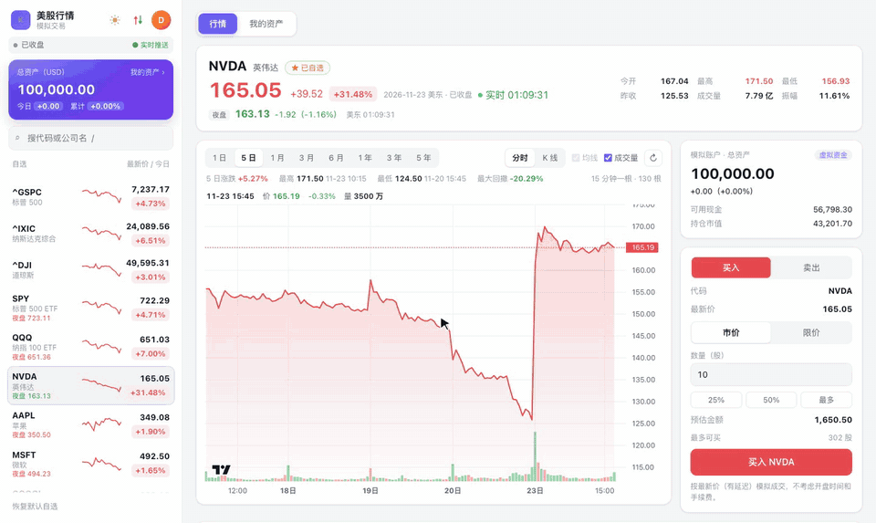

# 美股行情 · 模拟交易

自己看美股行情、做模拟交易的小工具。

**在线体验：<https://kline.belong.run>** · 宣传页：<https://kline.belong.run/intro>



- 前端：Next.js 14（App Router）+ lightweight-charts（TradingView 开源图表）
- 后端：FastAPI + yfinance（Yahoo Finance 非官方接口）+ Postgres（账号、模拟账户）
- 实时：后端连 Yahoo 实时价格流，再用 WebSocket（`/api/ws`）推给浏览器

## 启动

```bash
./start.sh
```

然后打开 http://localhost:5200 。第一次用先装依赖：

```bash
cd backend && uv sync
cd frontend && npm install
```

也可以分开起：后端 `cd backend && uv run uvicorn main:app --port 8090 --reload`，前端 `cd frontend && npm run dev`（Next 把 `/api/*` 转给 8090，见 `next.config.mjs`）。

## 功能

**行情**
- **实时推送**：盘中价格秒级跳动（报价头、自选、图表最后一根 K 线一起更新）；盘前 / 盘后 / 夜盘价格单独显示，不改正式收盘价
- 报价头：最新价、涨跌额、涨跌幅、今开 / 最高 / 最低 / 昨收 / 成交量 / 振幅、市场状态（盘前 / 交易中 / 盘后 / 已收盘），30 秒刷新
- 时间范围：1 日（5 分钟一根）、5 日（15 分钟一根）、1 月、3 月、6 月、1 年、3 年、5 年（日 K）；分时每分钟自动刷新
- 图表：分时（面积图，1 日带昨收虚线）/ K 线切换，均线 MA5 / 20 / 60、成交量可开关；鼠标移到哪根显示哪根的数据
- 区间统计：区间涨跌、最高最低（带时间）、最大回撤
- 自选：最新价、今日涨跌、近一个月走势小图；★ 加 / 移自选
- 搜索：输入代码或公司名联想（↑↓ 选、回车确认，按 `/` 聚焦搜索框）
- 加密货币（如 BTC-USD）显示「24 小时交易」，日期按 UTC
- 红涨绿跌 / 绿涨红跌，浅色 / 深色 / 跟随系统；设置存在浏览器里

**账号**
- 用户名 + 密码注册 / 登录（右上角头像）；不登录也能看行情，模拟交易和自选同步要登录
- 密码用标准库 `hashlib.scrypt` 加盐哈希；登录态是 JWT（HS256，30 天），放在 HttpOnly Cookie `sk_token` 里，前端 JS 读不到
- JWT 签名密钥本机第一次启动时随机生成在 `backend/data/secret.key`；部署时必须用环境变量 `SK_JWT_SECRET`
- 同一用户名 15 分钟内输错 10 次密码会被拦 15 分钟
- 每个账号一份模拟账户、一份自选；新账号第一次登录时把本机的自选传上去

**界面**
- 右上角：太阳 / 月亮一键切浅色深色（新主题从按钮处画圆铺开，用 View Transitions API）；齿轮里是涨跌颜色和「跟随系统」

**模拟交易（每个账号一份虚拟账户）**
- 初始资金 10 万美元（可在「重置模拟账户」改），数据存在 Postgres（本机默认 `postgresql://localhost/stock_kline`，环境变量 `DATABASE_URL` 可改）
- 买入 / 卖出，市价 / 限价，下单前确认；可撤未成交的限价单
- 持仓：成本价、最新价、市值、浮动盈亏；账户：总资产、可用现金、总盈亏
- 规则：按最新价（有延迟）成交，不考虑开盘时间、滑点和手续费；限价单每 15 秒按最新价检查一次
- 风控：单笔金额上限 5 万（`paper.py` 的 `MAX_ORDER_VALUE`）、买入不超过可用现金、不能做空

## 目录

```
backend/
  main.py      /api/kline、/api/quote、/api/search（带缓存）
  auth.py      /api/auth/*：注册、登录、退出、当前用户（JWT Cookie）
  db.py        Postgres 表结构：users / accounts / positions / orders / equity_snapshots / watchlists / login_fails
  scripts/migrate_sqlite.py  旧 SQLite 数据一次性搬到 Postgres
  live.py      /api/ws：实时推送（上游 Yahoo streamer，下游浏览器 WebSocket）
  paper.py     /api/paper/*：模拟账户；/api/watchlist：自选
frontend/src/
  app/                  Next 入口（layout、page、globals.css）
  components/App.tsx    页面主体：报价头、工具栏、图表、交易区
  components/Chart.tsx  图表（分时 / K 线 / 均线 / 成交量）
  components/Sidebar.tsx 自选、搜索、设置
  components/Trade.tsx  下单面板、持仓 / 委托
  components/Account.tsx 登录弹窗、头像菜单、齿轮设置、主题切换按钮
  lib/api.ts            行情接口、均线、区间统计、格式化
  lib/paper.ts          模拟账户接口
  lib/auth.ts           账号、自选同步接口
  lib/live.ts           实时推送：WebSocket 连接、断线重连、250ms 合并刷新
```

## 为什么前端不直接调 Yahoo

1. Yahoo 的接口不允许浏览器跨域请求；还要先拿 cookie / crumb，yfinance 帮着处理了，但它是 Python 库
2. 后端统一缓存（报价 20 秒、分时 1 分钟、日 K 5 分钟），自选一刷新十几个请求也不会被限流
3. 以后换付费数据源或券商 API，密钥只能放后端
4. 模拟账户的持仓、委托要存库、要撮合

## 实时推送怎么走

```
Yahoo streamer ──WebSocket──▶ backend/live.py Hub ──WebSocket /api/ws──▶ 浏览器
                （一条上游连接，订阅所有页面要的代码的并集；断线 3～60 秒退避重连；没有页面连着就断开）
```

- 浏览器连 `ws://localhost:8090/api/ws`，发 `{"type":"subscribe","symbols":[...]}`（每次发完整列表）
- 后端推 `{"type":"tick", "symbol", "price", "change_pct", "session"(pre/regular/post/overnight), "et_time", ...}` 和 `{"type":"status","upstream":...}`
- Next 的 rewrites 不转发 WebSocket，所以浏览器直接连 8090（可用 `NEXT_PUBLIC_WS_URL` 改）
- 走系统代理时 websockets 需要 `python-socks`（已在依赖里）
- 报价接口照样 30 秒轮询一次，用来补今开 / 昨收这些推送里没有的字段；K 线也照样轮询，推送只改最后一根

## 时间说明

所有时间都是**美东时间**。北京时间白天美股还没开盘，最新一根是上一个交易日；美股开盘后（北京时间 22:30，夏令时 21:30）出现当天的数据。

## 注意

- yfinance 是非官方接口：免费、有延迟、偶尔被限流或失效，只适合自己看
- 网络：浏览器只连本机后端；后端要能访问 Yahoo。国内有的网络直连不上，要开代理（系统代理 / `HTTPS_PROXY`）。
  代理开关切换后，实时推送会在 90 秒内自动重连（上游假死检测）
- 模拟账户只是练手，跟真实券商、真实资金都没有关系；不构成任何投资建议

## 部署到 Vercel

拆成两个 Vercel 项目，再加一个 Neon Postgres：

| 部分 | 放哪 | 域名（示例） |
|---|---|---|
| 前端 `frontend/` | Vercel 项目 stock-kline-web（Next.js） | kline.belong.run |
| 后端 `backend/` | Vercel 项目 stock-kline-api（FastAPI，Python 函数，美东 iad1，和 Neon 同机房） | kline-api.belong.run |
| 数据库 | Neon Postgres（Vercel Marketplace 里加，us-east-1） | — |

前端的 `/api/*` 由 Next rewrites 转发到后端，浏览器看来是同源，登录 Cookie 照常工作；
WebSocket 不走 rewrites，浏览器直连 `wss://kline-api.belong.run/api/ws`。

**后端环境变量**
- `DATABASE_URL`：Neon 的 pooled 连接串（主机名带 `-pooler`）
- `SK_JWT_SECRET`：随机 64 位十六进制，`python3 -c "import secrets;print(secrets.token_hex(32))"`
- `SK_WS_ORIGINS`：`https://kline.belong.run`（只让自己的前端连推送）

**前端环境变量**（构建时生效，改了要重新部署）
- `API_ORIGIN`：`https://stock-kline-api.vercel.app`（服务端转发，用 vercel.app 域名就行）
- `NEXT_PUBLIC_WS_URL`：`wss://kline-api.belong.run/api/ws`

**步骤**
1. 后端：`cd backend && npx vercel` 建项目 → 在项目里加 Neon 存储、填上面的环境变量 → `npx vercel --prod`
2. 建表并搬本机数据：`DATABASE_URL='<Neon 直连串>' uv run python scripts/migrate_sqlite.py`（本机已经是 Postgres 的话用 `pg_dump stock_kline | psql '<Neon 直连串>'`）
3. 前端：`cd frontend && npx vercel` → 填环境变量 → `npx vercel --prod`
4. 两个项目各绑自定义域名，DNSPod 按 Vercel 给的值加 CNAME（和 notes.belong.run 一样）

**已知限制**
- Vercel 上 WebSocket 连接最长跟函数时长一样（默认 5 分钟）会断，前端会自动重连，看到「重连中」闪一下是正常的。
- Yahoo 对云服务器 IP 可能限流（yfinance 报 Too Many Requests），部署后先观察；不行再换数据源或给后端换出口。

## 宣传页

静态页面放在 `frontend/public/intro/`（`index.html` + 演示视频 `demo.mp4` / 动图 `demo.gif` + 截图），跟前端一起部署，访问 `/intro` 就是宣传页（`next.config.mjs` 里的 rewrite）。
